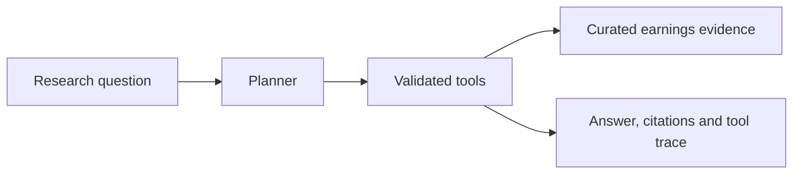

# Earnings Research Agent

A Streamlit research assistant that turns a financial question into tool calls and shows the sources and arithmetic behind its answer. The demo uses Microsoft’s FY25 Q4 earnings release and conference call, with FY24 Q4 figures for year-over-year comparisons.

## Example investigation

> Compare Microsoft FY25 Q4 revenue and operating margin year over year.

| Finding | Source and calculation |
| --- | --- |
| Revenue rose **18.10%** | ($76,441m ÷ $64,727m − 1) × 100 |
| Operating margin rose **1.76 percentage points** | 44.90% minus 43.14%, calculated from quarterly operating income divided by revenue |

Both calculations link to the [quarterly income statements in Microsoft’s earnings release](https://www.microsoft.com/en-us/Investor/earnings/FY-2025-Q4/press-release-webcast). Ask about Azure growth and capex for an example that retrieves source-linked notes from the release and [earnings call](https://www.microsoft.com/en-us/investor/events/fy-2025/earnings-fy-2025-q4).

## How it works



- **Lookup** retrieves a quarterly metric and its source. Operating margin is calculated in Python.
- **Compare** calculates year-over-year growth or the change in margin in percentage points.
- **Search** ranks curated earnings notes for supported topics and returns the matching note and source.
- **Planning** defaults to a rule-based offline planner. The optional OpenAI planner chooses tools through a bounded function-calling loop. The app renders tool results directly, keeping the calculations and source URLs inspectable.

The corpus is a static, manually curated set of financial facts and paraphrased commentary. Coverage is limited to Microsoft FY24 Q4 and FY25 Q4 financials and selected FY25 Q4 call topics.

## Run locally

Use Python 3.11 or newer.

```bash
python -m pip install -r requirements.txt
python -m unittest -v
python -m streamlit run app.py
```

The offline demo needs no API key. To enable model-driven planning, set the environment variable `OPENAI_API_KEY` before launching Streamlit and select **OpenAI planner**. `OPENAI_MODEL` optionally overrides the default, `gpt-4.1-mini`. In this mode the API receives the question and tool results. The automated tests use a mocked model response and require no credentials.
